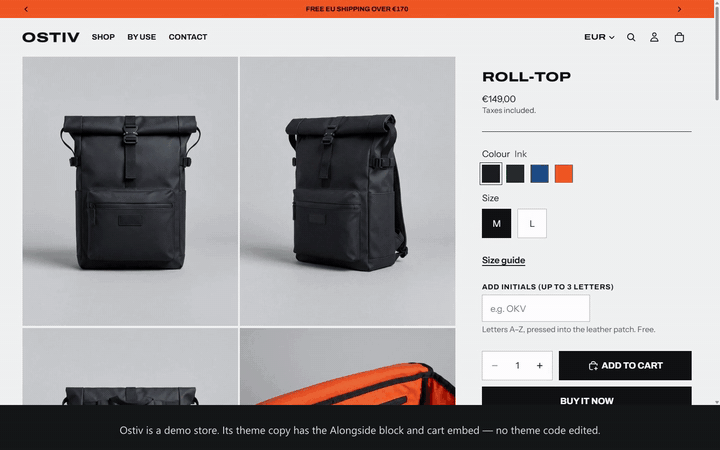
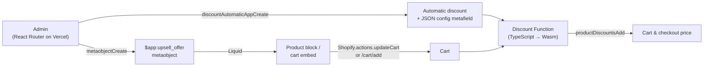

# Alongside — cart add-on offers for Shopify (demo app)

A portfolio demo: a custom Shopify app that replaces a paid "frequently bought together / cart upsell" app. A merchant pairs a product with up to three add-ons and a discount; shoppers see the offer on the product page and in the cart, and a **Shopify Function** applies the price in the cart and at checkout.

It has the three parts such projects usually need: an **embedded admin** (React Router + Polaris web components), a **theme app extension** (a product page block and a cart app embed) and a **Discount Function**.

For store staff: [STAFF-GUIDE.md](STAFF-GUIDE.md) — create, change and turn off offers.



> Demo: the store (Ostiv, a fictional bag brand) and its products are made up; orders are not fulfilled. No usage, conversion or revenue figures are claimed — the numbers below are tests and measurements only.

## What it does

- **Offers in the admin.** Name, a heading for shoppers, trigger products and 1–3 add-ons (Shopify resource picker), percentage or fixed amount, where to show it. Turn on / off, delete with confirmation. Saving writes two things from the same form: a metaobject for the storefront and an automatic discount for checkout.
- **Product page block.** On a trigger product the add-ons are listed with the regular and the offer price ("15% off with Roll-Top" — the discount needs the trigger in the cart). Variant picker when a product has variants.
- **Cart embed.** In the cart drawer and on the cart page, offers whose trigger is in the cart, without the add-ons already added. Works with Horizon and Dawn out of the box; other themes set a CSS selector in the embed settings.
- **Discount Function.** Each offered product is discounted on at most as many units as there are trigger units (1 backpack → 1 discounted sleeve). Shown as "Complete your setup: 15% off" in the cart and at checkout.
- **Add to cart** goes through Shopify's standard storefront actions (`Shopify.actions.updateCart`), so the theme refreshes its own cart; without them — or without JavaScript — each add-on is a plain `/cart/add` form.

## How it works



- **The storefront never calls the app server.** Offers and prices are rendered in Liquid from the app-owned metaobject, so the widget keeps working if the admin is down or asleep.
- **One source for the price.** The metaobject and the discount's JSON configuration are built from the same draft; a contract test checks that the function accepts exactly what the admin writes.
- **The database holds only the shop session** (Prisma + Postgres). Offers live in Shopify.

## Stack

- Shopify CLI 5, React Router 7 app template, `@shopify/shopify-app-react-router` 4, Admin GraphQL API 2026-10, Polaris web components 2, App Bridge
- Shopify Functions: Discount Function API 2026-10 in TypeScript (Javy → WebAssembly)
- Theme app extension: Liquid, app-owned metaobjects, standard storefront actions and events, vanilla JS (esbuild)
- Prisma + Postgres (Neon), Vercel (`@vercel/react-router`)
- Vitest, `@shopify/shopify-function-test-helpers`, Playwright, axe-core, Lighthouse

## Project layout

| Path | What's there |
|---|---|
| `app/routes/` | Admin pages: offer list (`app._index.tsx`), create / edit form (`app.offers.$id.tsx`), webhooks (uninstall, scopes, privacy compliance) |
| `app/models/offer.ts` | Pure offer logic with unit tests: form parsing and validation, metaobject fields, discount input, function config |
| `app/models/offers.server.ts` | Admin GraphQL: create / update / enable / delete an offer (discount + metaobject), products for the list |
| `app/components/ProductPicker.tsx` | Resource picker field that works with the contextual save bar |
| `extensions/alongside-discount/` | Discount Function: input query, logic, unit tests, Wasm fixture tests (one recorded from a real cart) |
| `extensions/alongside-theme/` | Theme app extension: `blocks/product-offers.liquid`, `blocks/cart-offers.liquid` (app embed), `snippets/` (offer card, inline styles), built `assets/alongside.js` |
| `storefront/alongside.js` | Readable source of the storefront script (minified into the extension) |
| `e2e/` | Playwright: product page, cart drawer and page, checkout, no-JS, axe — on two themes |
| `scripts/perf.mjs` | Lighthouse before / after on a product page |
| `scripts/demo/` | Reproducible overview video: Playwright drives the admin and storefront, DevTools screencast records, ffmpeg adds captions |
| `shopify.app.toml` / `shopify.app.production.toml` | App config: scopes, metaobject definition, webhooks — development and production (Vercel) |
| `STAFF-GUIDE.md` | Guide for store staff: create, change, turn off an offer; what to check when it does not show |
| `notes/` | Build notes per stage (in Ukrainian) |

## Run locally

Requirements: Node 22, a Shopify Partner / Dev Dashboard account and a development store, a Postgres database.

```bash
npm install
shopify app config link              # link to your app (writes shopify.app.toml)
echo DATABASE_URL=... >> .env         # Postgres for sessions
echo DATABASE_URL_UNPOOLED=... >> .env
npx prisma migrate deploy
npm run dev                          # = shopify app dev; builds the storefront script first
```

`shopify app dev` opens a Cloudflare tunnel; if it is blocked on your network, start your own (`ngrok http 3000`) and pass `--tunnel-url https://<host>:3000`.

Then: open the app in the store admin and create an offer; in the theme editor turn on **App embeds → Add-on offers in cart** and add the **Add-on offers** block to the product template.

## Deploy

1. **Admin** — Vercel with the React Router preset (`react-router.config.ts`, `vercel.json`). Environment variables: `SHOPIFY_API_KEY`, `SHOPIFY_API_SECRET`, `SCOPES` (from `shopify app env show`), `SHOPIFY_APP_URL`, `DATABASE_URL`, `DATABASE_URL_UNPOOLED`. The build runs `prisma migrate deploy`.
   ```bash
   npm run deploy:admin
   ```
2. **App version** (config, Function, theme extension) — `shopify.app.production.toml` has the Vercel URL:
   ```bash
   npm run build:storefront && npm run deploy
   ```
3. Install the app on the store and set up the theme as in *Run locally*.

## Rolling back / switching off

- **One offer:** *Turn off* in the offer list (the discount is deactivated, the metaobject goes to draft and disappears from the storefront).
- **Storefront only:** in the theme editor turn off the app embed and remove the block — prices at checkout stop changing only when the offers are turned off.
- **App code:** Dev Dashboard → Versions → release the previous version; Vercel → promote the previous deployment (`vercel rollback`).
- **Everything:** uninstall the app — Shopify removes its discounts and the metaobject definition. Offer entries are kept for a while and come back if the app is reinstalled soon; their discounts do not, so delete and recreate such offers.

## Scripts

| Script | What it does |
|---|---|
| `npm run dev` | `shopify app dev` (admin, Function and theme extension with hot reload) |
| `npm run build:storefront` | Minify `storefront/alongside.js` into the theme extension |
| `npm test` | Admin unit tests (Vitest) |
| `npm test` in `extensions/alongside-discount` | Function unit tests and Wasm fixture tests |
| `npm run test:e2e` | Playwright on the dev store (two themes); the first run opens a window to unlock the storefront password once |
| `npm run perf -- <beforeThemeId> <afterThemeId> [runs]` | Lighthouse, mobile, median of runs |
| `npm run typecheck` / `npm run lint` | TypeScript and ESLint |
| `npm run deploy` / `npm run deploy:admin` | Release an app version / deploy the admin |

## Quality

Measured on 13 Nov 2026.

- **Tests:** 21 admin unit tests; 13 function unit tests + 5 Wasm fixture tests; 7 end-to-end tests × 2 themes (Horizon copy and stock Dawn 16), green on the released version. Guard tests were checked by mutating the code they protect.
- **Accessibility:** axe (WCAG 2.2 A/AA) — 0 violations in the product block and the cart offer on both themes. Named buttons ("Add Rain Cover, 15% off with Roll-Top"), labelled prices, `role="status"` announcements, focus kept in the cart after it re-renders, 44 px targets, `prefers-reduced-motion`.
- **Discount Function:** 0.29–0.41 million instructions on real carts (limit 11 million); 7.6 million on a 200-line cart (69 %); 3.7 KB Wasm (limit 256 KiB).
- **Storefront cost** (Lighthouse 13, mobile, product page, 5 runs, median, live theme vs. its copy with Alongside): Performance 37 → 37, LCP 7.8 s → 7.8 s. Alongside adds **one request** (`alongside.js`, 4.7 KB, 2.1 KB gzip, deferred), **no render-blocking resources** and **no requests to the app server**; its script does not appear in Lighthouse's bootup-time list (under 50 ms). The low Performance score is the store page with Shopify's platform scripts on a throttled mobile profile, the same with and without the app.

## Known limitations

- Triggers are products, not collections.
- Liquid reads up to 50 offers; Shopify allows up to 25 active automatic app discounts per store.
- Offers do not stack with other product discounts on the same add-on (on purpose: another discount would change the promised price).
- Fixed-amount discounts are in the store currency; other Shopify Markets currencies were not tested.
- The function is TypeScript for readability; on very large carts (hundreds of lines) Rust would leave more instruction headroom.
- After releasing an app version, do not run `shopify app dev clean` on the same store: it removes data and extension references created under the dev preview. Reinstalling the app recovers the definitions.
- The storefront rate-limits `/cart/add` from one IP; the e2e suite runs in one worker with pauses and retries on HTTP 429.
